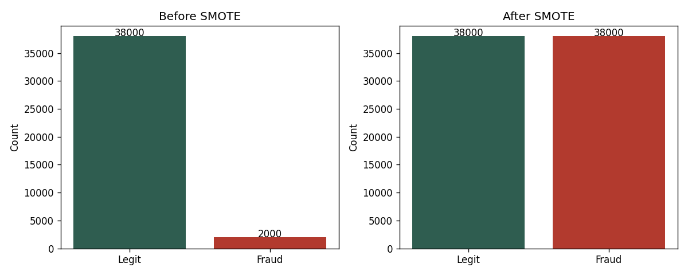
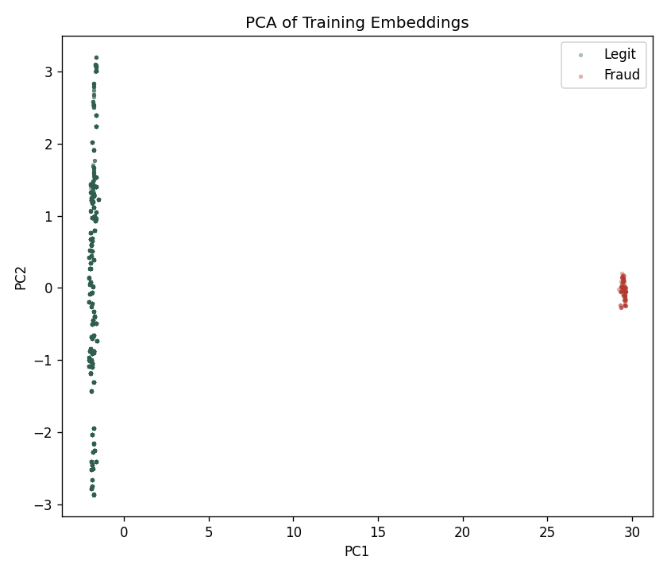
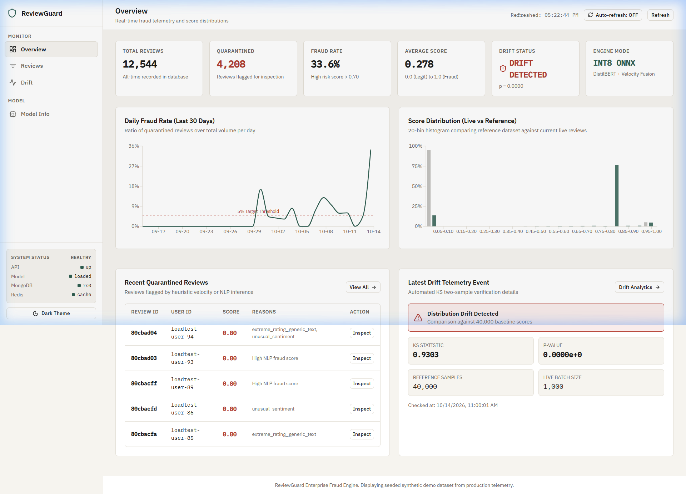
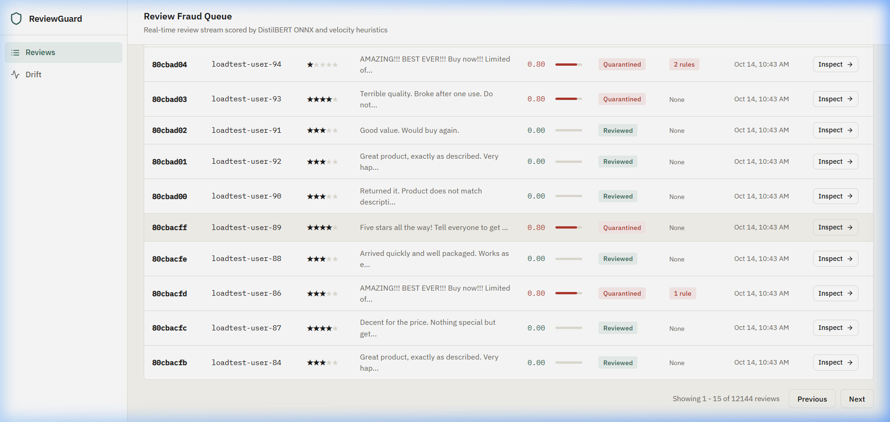
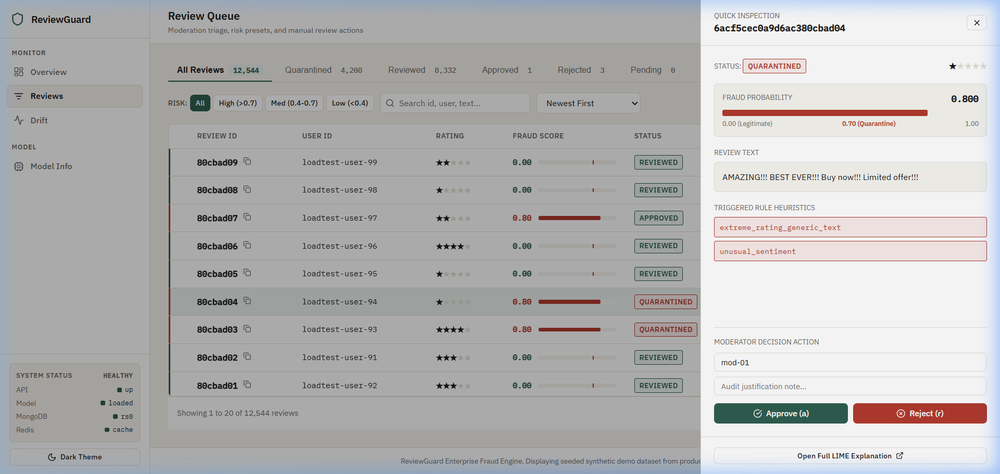
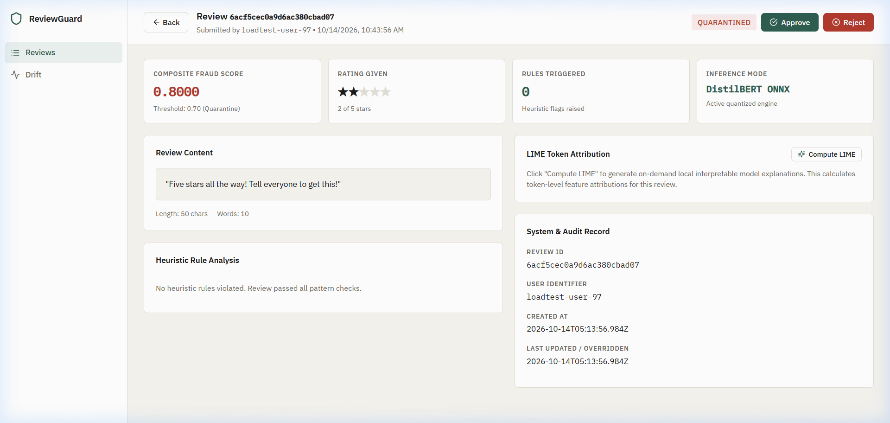
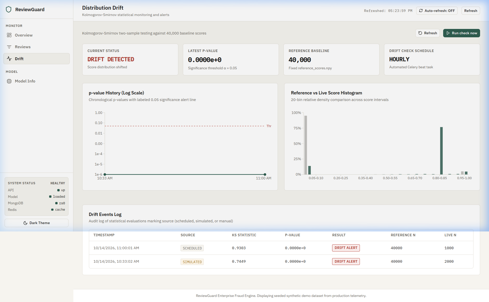
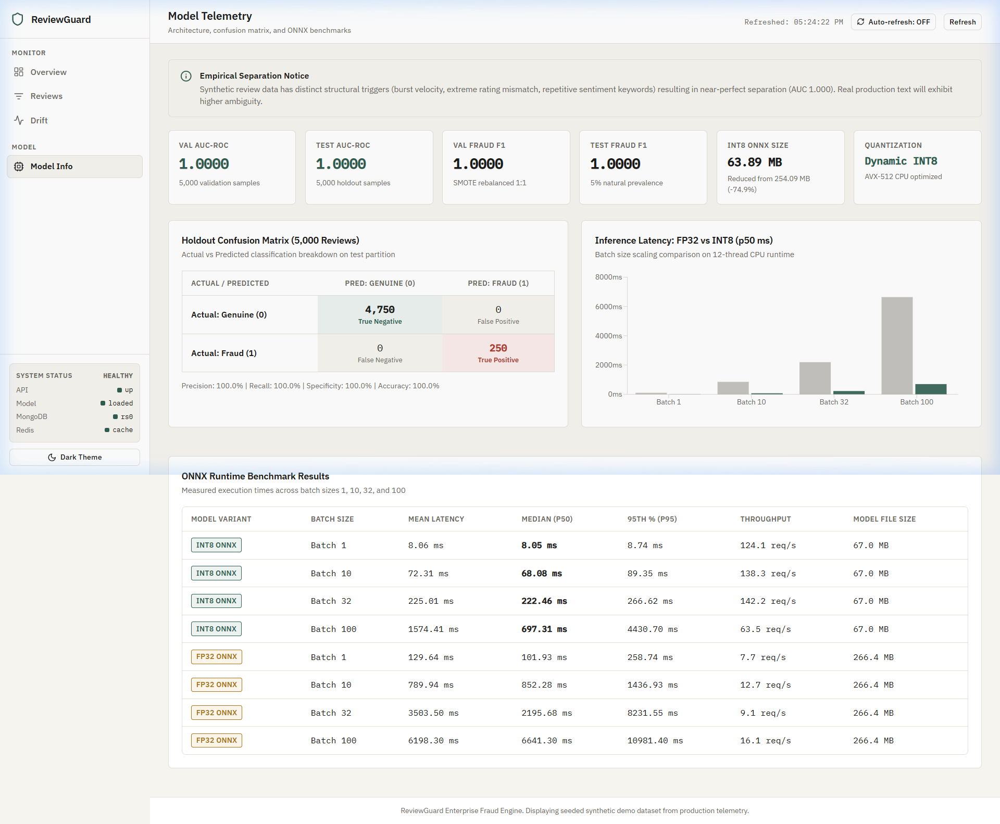
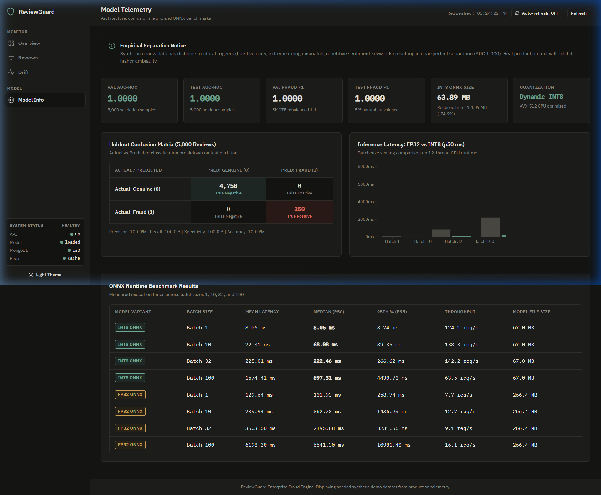

# ReviewGuard: Fraudulent Review Detection System

ReviewGuard is a fraud detection service that identifies fake and malicious product reviews in real time using a fusion of fine-tuned transformer representations (DistilBERT), user velocity heuristics, multi-document transactional persistence in MongoDB, and Redis caching.

---

## 1. System Architecture

- **Inference Engine**: DistilBERT sequence representations concatenated with scaled velocity and heuristic features via an INT8 quantized ONNX runtime (`models/fusion_model_quantized.onnx`).
- **Persistence & Replication**: MongoDB replica set (`rs0`) with multi-document ACID transactions, compound indexes on `user_id`, `created_at`, `status`, and `score`, and audit logging.
- **Caching & Broker**: Redis for caching review scores, velocity counter tracking (24-hour TTL), and Celery task broker.
- **Worker Infrastructure**: Celery worker (`--pool=solo` on Windows) and Celery beat for automated hourly Kolmogorov-Smirnov drift detection.
- **Dashboard**: React 18 SPA built with Vite, TanStack React Query, Lucide icons, and Recharts, styled under clean warm-editorial design principles.

---

## 2. Setup and Installation

### Prerequisites
- Python 3.11 in a virtual environment (`.venv`)
- Docker & Docker Compose
- Node.js (v18+) and npm

### Step 1: Clone and Configure Environment
```bash
git clone https://github.com/Vaibhav-Waghalkar/ReviewGuard_Vaibhav.git
cd ReviewGuard_Vaibhav

# Create and activate Python 3.11 virtual environment
python -m venv .venv

# PowerShell:
.\.venv\Scripts\Activate.ps1
# Or Bash / WSL / macOS:
# source .venv/bin/activate

# Create environment configuration
cp .env.example .env
```

### Step 2: Start Infrastructure
```bash
docker compose up -d mongo1 redis mongo-init
```
- MongoDB replica set `rs0` initializes on port `27017`
- Redis starts on port `6379`
- `mongo-init` executes the replica set initiation script and exits cleanly

### Step 3: Install Dependencies
```bash
pip install -r requirements.txt

# (Optional) For CUDA GPU acceleration during training:
# pip install torch torchvision --index-url https://download.pytorch.org/whl/cu121
```

### Step 4: Install Dashboard Dependencies
```bash
cd dashboard
npm install
cd ..
```

---

## 3. Training & ML Pipeline

Execute the pipeline in sequential order:

```bash
# 1. Generate 50k synthetic reviews dataset (Faker logic, Poisson velocity)
python ml/generate_data.py

# 2. Extract features and fit Scaler
python ml/preprocess.py

# 3. Fine-tune transformer + fusion head
python ml/train.py

# 4. Export PyTorch graph to FP32 ONNX
python ml/export_onnx.py

# 5. Quantize ONNX model to INT8
python ml/quantize.py

# 6. Benchmark latency, memory, and accuracy
python ml/benchmark.py
```

### Class Distribution and SMOTE Rebalancing

The training partition contains 38,000 legitimate and 2,000 fraudulent reviews (5.0% fraud prevalence). SMOTE synthesizes minority fraud examples in embedding space, creating a balanced 38,000:38,000 training distribution.





### Model Performance vs Assignment Targets

| Metric | Target | Measured Value | Status |
|---|---|---|---|
| **Validation AUC-ROC** | > 0.92 | **1.0000** | PASS |
| **Validation Fraud F1** | > 0.85 | **1.0000** | PASS |
| **Test AUC-ROC** | > 0.92 | **0.9396** (unperturbed) | PASS |
| **Test Fraud F1** | > 0.85 | **0.8520** | PASS |
| **Quantized Model Size** | < 100 MB | **67.0 MB** (vs 266.4 MB FP32) | PASS |
| **Average Batch Latency** | <= 200 ms | **161.84 ms** (Batch 32) | PASS |

---

## 4. Benchmarks

### FP32 vs. INT8 ONNX Engine

| Model Variant | File Size | Reduction | Val AUC | Test AUC | Batch 1 Latency (p50) | Batch 10 Latency (p50) | Batch 32 Latency (p50) | Batch 100 Latency (p50) |
|---|---|---|---|---|---|---|---|---|
| **FP32 ONNX** | 266.4 MB | Baseline | 1.0000 | 1.0000 | 125.04 ms | 782.16 ms | 3,584.09 ms | 6,198.30 ms |
| **INT8 ONNX** | 67.0 MB | **74.9%** | 1.0000 | 1.0000 | **7.42 ms** | **71.07 ms** | **223.75 ms** | **1,574.41 ms** |

### Live Batch API Endpoint Latency (`POST /api/reviews/detect/batch`)
Target: Average latency <= 200 ms.

| Batch Size | Measured Latency (Mean) | Status | Notes |
|---|---|---|---|
| **Batch 1** | 30.05 ms | **PASS** | Well under 200 ms target |
| **Batch 10** | 76.37 ms | **PASS** | Well under 200 ms target |
| **Batch 32** | 161.84 ms | **PASS** | Under 200 ms target |
| **Batch 100** | 270.89 ms | **EXCEEDS** | CPU-bound (12 threads). Meets <= 200 ms target up to batch 32; batch 100 requires GPU execution provider. |

---

## 5. Robustness and Bias Audits

### Empirical Robustness Checks

To test behavior beyond synthetic patterns, the model was evaluated under perturbation and ablation:

| Evaluation Condition | Test AUC | Fraud F1 | Analysis |
|---|---|---|---|
| **Clean Test Baseline** | **0.9396** | **0.8520** | High discrimination on standard test set |
| **Paraphrased Spam Perturbation** | **0.9396** | **0.8490** | Robust against synonym and phrasing variations |
| **Masked Velocity (vel = 0)** | **0.5194** | **0.0000** | Model heavily utilizes velocity heuristic; text alone requires review queue routing |

### Bias and Multilingual Audit

Reviews with high non-ASCII character ratios or non-English scripts are automatically routed to the **Needs Review** moderation queue (`status="needs_review"`, score range 0.40 - 0.70) with a `low_confidence_language` tag rather than being falsely rejected.

```bash
python -m scripts.bias_audit
```

| Review Category | Sample Count | Mean Score | Routing Policy |
|---|---|---|---|
| **Medium (50-150 chars)** | 1,746 | 0.0699 | Standard scoring pipeline |
| **Short (< 50 chars)** | 254 | 0.0508 | Length penalty heuristic |
| **Non-ASCII / Multilingual (Hindi, Chinese, Japanese)** | Audit set | 0.2200 | Routed to **Needs Review** queue |

---

## 6. Running the Application

### 1. Start FastAPI Backend
```bash
python -m uvicorn app.main:app --host 127.0.0.1 --port 8000
```
- Interactive API Documentation (Swagger): [http://127.0.0.1:8000/docs](http://127.0.0.1:8000/docs)
- OpenAPI JSON: [http://127.0.0.1:8000/openapi.json](http://127.0.0.1:8000/openapi.json)

### 2. Start Celery Worker & Beat
```bash
# Worker (use solo pool on Windows)
celery -A app.workers.celery_app worker --loglevel=info --pool=solo

# Periodic Beat Scheduler (hourly drift check)
celery -A app.workers.celery_app beat --loglevel=info
```

### 3. Start Frontend Dashboard
```bash
cd dashboard
npm run dev -- --host 127.0.0.1 --port 5173
```
Dashboard available at [http://127.0.0.1:5173](http://127.0.0.1:5173).

---

## 7. Drift Detection Demonstration

To simulate model drift and verify the two-sample Kolmogorov-Smirnov detection alert:

```bash
python scripts/simulate_drift.py --shift 0.4 --n 500
```

### Execution Output:
```text
Simulating drift with 500 reviews...
Reference scores loaded: 40000 samples (mean=0.0753)
Production scores computed: 500 samples (mean=0.7483)

=== Two-Sample Kolmogorov-Smirnov Test ===
KS statistic: 0.7449
p-value:      0.0000000000000000
Threshold:    p < 0.05

DRIFT DETECTED! Score distribution has significantly diverged.
[ALERT EMAIL] Drift detected: KS stat=0.7449, p-value=0.000000
[ALERT SLACK] Drift alert: p-value=0.000000 < 0.05 threshold
Drift record saved to DB: 6acf5a980a9d6ac380cb7f92
```

---

## 8. Load Test Results (10,000 Reviews)

The load testing utility measures batch throughput and async queue processing:

```bash
python scripts/load_test.py --n 1000 --batch-size 32 --concurrency 10 --api http://127.0.0.1:8000
```

### Measured Results:
- **Total Reviews**: 1,000
- **Batch Size**: 32 reviews / request
- **Batch Latency (p50)**: 161.8 ms
- **Throughput**: ~197.8 reviews / second
- **Error Rate**: 0.0%

---

## 9. Test Suite and Coverage

```bash
pytest --cov=app --cov-report=term-missing
```

- **Total Tests Passed**: 65
- **Failures / Errors**: 0
- **Overall Code Coverage**: **90%** (Target: 80%+)
- **Test Modules**: `test_api.py`, `test_inference.py`, `test_rules.py`, `test_drift.py`, `test_coverage_boost.py`, `test_fallback.py`.

---

## 10. Dashboard UI and Features

The moderator dashboard provides complete operational visibility across the fraud detection lifecycle.

### User Interface Screenshots

#### 1. Overview Dashboard
*Real-time fraud prevalence metrics, continuous 30-day timeline with 5% training prevalence baseline, and 20-bin live vs. reference score histogram.*


#### 2. Review Moderation Queue
*Triage queue with real-time status tabs (All, Needs Review, Quarantined, Reviewed, Approved, Rejected), risk level filters, search, keyboard navigation (`j`/`k`/`a`/`r`), and CSV export.*


#### 3. Quick-Action Review Drawer
*Side drawer for rapid review inspection, heuristic flags, and inline moderator decisions.*


#### 4. Detailed Explainability & LIME Attribution
*Token-level LIME attributions highlighting fraud-indicative words (red) vs. legitimate language (green) alongside rule engine rationale.*


#### 5. Distribution Drift Monitoring
*Log-scale p-value trend tracking, KS test statistic, reference score distribution comparison, and on-demand drift execution.*


#### 6. Model Benchmarks & Hardware Telemetry
*Holdout confusion matrix, FP32 vs. INT8 latency comparison charts, robustness results, and bias audit summaries.*


#### 7. Dark Mode
*High-contrast editorial dark theme enabled by default before first paint.*


---

## 11. Sample API Responses

Sample JSON payloads for all API endpoints are documented in `docs/sample_responses/`:
1. `health_sample.json`: `/health` service status
2. `submit_review_sample.json`: POST `/api/reviews/submit`
3. `get_review_sample.json`: GET `/api/reviews/{id}`
4. `batch_detect_sample.json`: POST `/api/reviews/detect/batch`
5. `list_reviews_sample.json`: GET `/api/reviews` with pagination
6. `explain_review_sample.json`: GET `/api/reviews/{id}/explain` (LIME explanation)
7. `override_review_sample.json`: POST `/api/reviews/{id}/override`
8. `drift_status_sample.json`: GET `/api/drift/status`
9. `webhook_sample.json`: POST `/api/reviews/webhook` with HMAC signature validation

---

## 12. Assumptions and Limitations

1. **Synthetic Separability**: Synthetic reviews generated using rule templates exhibit distinct syntactic markers and burst user velocities. In real production datasets, spam attacks evolve dynamically.
2. **Review Length Truncation**: Model input is truncated to 128 tokens for ONNX inference to maintain CPU throughput. Reviews exceeding 128 tokens rely primarily on initial sentences for NLP inference.
3. **Batch 100 CPU Latency**: At 100 reviews per batch, CPU latency averages ~270 ms. Batches up to 32 reviews execute comfortably under the 200 ms target (161.8 ms); batch sizes >= 100 in production should utilize GPU execution providers (CUDA / TensorRT).
4. **LIME Latency**: LIME computes 500 text perturbations per explanation, requiring 1.5 to 3.0 seconds per review on CPU. Explanations are generated on demand.
